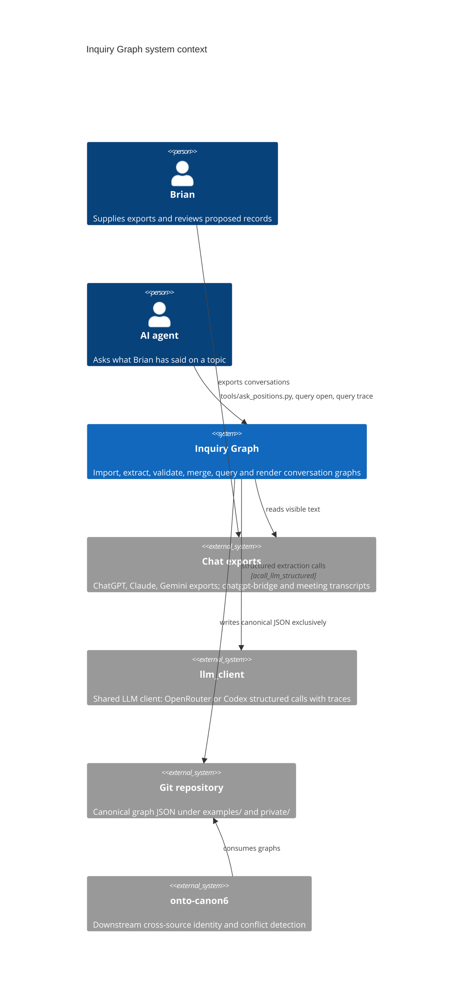
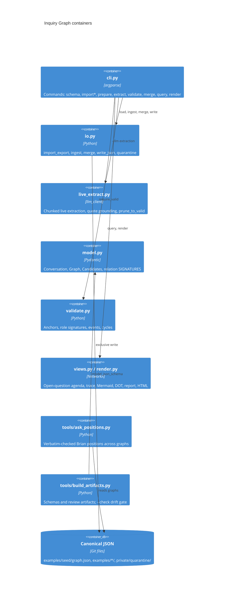

# Inquiry Graph architecture

This is the system model in arc42 shape. Each rule below has one owner file, the tests
that would fail if it broke, and the decision record that explains it; that mapping is
machine-checked in [trace.yaml](trace.yaml). The goal is in
[GOAL.md](../architecture/GOAL.md) and the requirements in
[requirements.md](../requirements.md). Older V1 boundary notes are in
[docs/architecture.md](../architecture.md).

## 1. Introduction and Goals

Inquiry Graph is a local Python package (`src/inquiry_graph`, CLI `inquiry-graph`) plus
a few research tools under `tools/`. It imports visible conversation text, extracts
typed content, relations, moves and actor-relative events, checks every quote against
its source message, and writes canonical JSON that agents query. The top quality goals
are exact grounding, stance kept apart from content, and never replacing good data with
bad output ([GOAL.md](../architecture/GOAL.md), "Quality Goals").

## 3. Context and Scope

Inputs are export files Brian supplies; the only network dependency is the shared
`llm_client` used by live extraction. Everything else runs offline.

Out of scope: hidden reasoning, automatic harvesting of all chats, cross-source identity
(onto-canon6), and formal warrant theory (`epistemic-warrant`).

## 5. Building Block View

| Block | Responsibility | Owns rules |
| --- | --- | --- |
| `src/inquiry_graph/io.py` | Import, ingest, merge, atomic writes, quarantine | RULE-ACTIVE-BRANCH, RULE-REVIEW-RESET, RULE-EXCLUSIVE-WRITE, RULE-EXACT-MERGE |
| `src/inquiry_graph/cli.py` | Command routing, output-path guard, failure quarantine | RULE-QUARANTINE, RULE-SOURCE-NOT-OVERWRITTEN |
| `src/inquiry_graph/validate.py` | Semantic validation beyond JSON shape | RULE-EXACT-ANCHOR, RULE-ROLE-SIGNATURE |
| `src/inquiry_graph/live_extract.py` | Live extraction through `llm_client` | RULE-LIVE-GROUNDING |
| `src/inquiry_graph/views.py` | Actor-scoped agenda and trace views | RULE-STANCE-SEPARATE |
| `tools/ask_positions.py` | Cross-chat positions answer path | RULE-VERBATIM-POSITIONS |
| `tools/build_artifacts.py` | Generated schemas and review artifacts | RULE-SCHEMA-REPRODUCIBLE |

`src/inquiry_graph/linker.py` (cross-conversation link proposals) and
`src/inquiry_graph/bridge.py` (chatgpt-bridge and exporter imports) are supporting
blocks without their own rules here.

## 6. Runtime View

**Extract (the main write path).** `inquiry-graph extract` enters `run()` at
`src/inquiry_graph/cli.py:70`. Before anything else it refuses an output path that is
an input or source snapshot (`src/inquiry_graph/cli.py:78`). It loads and validates the
Conversation, then either parses a response file and calls `ingest`
(`src/inquiry_graph/io.py:120`), which resets every candidate's `review_status` to
`proposed` (`src/inquiry_graph/io.py:126`), or calls `llm_extract`
(`src/inquiry_graph/cli.py:168`). Live extraction splits the conversation into chunks;
each chunk is answered from cache or through `acall_llm_structured` with
`task="extraction"` and trace id `inquiry-graph/live-extract/<conversation>/chunkNN`
(`src/inquiry_graph/live_extract.py:486`), then quotes are grounded and the graph is
pruned until valid (`prune_to_valid`, `src/inquiry_graph/live_extract.py:426`). The
graph is written by `write_json` (`src/inquiry_graph/cli.py:110`), which writes a
temporary file and links it into place exclusively (`src/inquiry_graph/io.py:35`),
replacing only with `--force` (`src/inquiry_graph/io.py:32`). Any exception sends the
raw response and error to `quarantine` (`src/inquiry_graph/cli.py:112`,
`src/inquiry_graph/io.py:171`) and the command fails.

**Import.** `import_export` (`src/inquiry_graph/io.py:42`) follows the `current_node`
ancestor chain only (`src/inquiry_graph/io.py:60`) and skips hidden, tool and non-text
parts (`src/inquiry_graph/io.py:91`), recording the skip count in a coverage note.

**Merge.** `merge` (`src/inquiry_graph/io.py:149`) unions graphs by id and raises an
identity conflict when two different records share an id
(`src/inquiry_graph/io.py:161`); the result is written at
`src/inquiry_graph/cli.py:127`.

**Ask positions.** `records()` (`tools/ask_positions.py:20`) reads every graph and keeps
an event only when its actor and the anchored message's speaker are Brian and the quote
is verbatim in that message (`tools/ask_positions.py:34`).

## 8. Cross-cutting Concepts

- Exact grounding: every semantic record carries anchors (message id, Unicode offsets,
  quote); `validate` (`src/inquiry_graph/validate.py:7`) rejects any mismatch.
- Review boundary: extraction output is always `proposed`; only a person confirms.
- Actor-relative state: stance and question status are events with an actor and an
  occurrence, never a global status on the content (ADR-002).
- Canonical JSON in Git, exclusive writes, private quarantine for failures (ADR-003, ADR-006).
- Observability: live extraction writes a report (chunks, drops by reason, kept counts,
  cost, trace ids), and every model call carries a stable trace id in `llm_client`.

## 10. Quality Requirements

| Quality | Scenario | Check |
| --- | --- | --- |
| Grounding | A record whose quote does not match the source at its offsets | `tests/test_validation.py::test_unicode_anchor` fails validation |
| Attribution | An assistant answer to a user question | `tests/test_pipeline.py::test_answer_does_not_close_user_question` keeps it open |
| Safety of data | A write to an existing graph without `--force` | `tests/test_pipeline.py::test_atomic_no_overwrite` refuses |
| Failure isolation | A transport error during live extraction | `tests/test_pipeline.py::test_transport_error_quarantined` quarantines, writes no graph |
| Determinism | Rendering under different hash seeds | `tests/test_pipeline.py::test_render_deterministic_across_hash_seeds` |
| Verbatim positions | A paraphrased quote attributed to Brian | `tests/test_ask_positions.py::test_drops_non_verbatim_quote` drops it |
