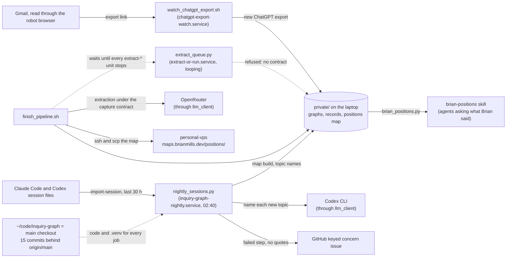

# System model (planning package)

This page is the system model the planning package names. It does not replace the two existing
documents; it joins them and adds what neither has, a record-type inventory with writers and readers.

- [docs/model/ARCHITECTURE.md](../model/ARCHITECTURE.md): context diagram, building blocks, runtime
  walk-through and quality checks (the `system_model.prose` of `.agentic/repo.yaml`).
- [docs/architecture/arc42.md](../architecture/arc42.md) and
  [docs/architecture/model.c4](../architecture/model.c4): the arc42 front and the module diagram that
  `code2check arch gen` turns into `.importlinter` (19 import contracts, all kept on 2026-10-27).

The line numbers in ARCHITECTURE.md's runtime view have moved since it was written (open question
Q4); the lines below are current at the package's subject revision.

## What it stores

Canonical records are JSON files validated by Pydantic models in `src/inquiry_graph/model.py`
(`extra="forbid", strict=True`, `src/inquiry_graph/model.py:8`). There is no database
([ADR-003](../decisions/003-json-and-libraries.md)).

| Record type | Defined at | Written by | Read by |
| --- | --- | --- | --- |
| `Conversation` (with `Participant`, `Message`) | `src/inquiry_graph/model.py:27` | `inquiry-graph import`, `import-bridge`, `import-exporter`, `import-session` (`src/inquiry_graph/cli.py:94`, `:126`, `:131`, `:136`) | `prepare`, `extract`, `validate` |
| `Candidates` (proposed nodes, relations, moves, events) | `src/inquiry_graph/model.py:118` | a response file, or live extraction (`src/inquiry_graph/live_extract.py:302`, `convert`) | `ingest` (`src/inquiry_graph/io.py:126`), which resets every record to `proposed` |
| `Graph` (all records plus `Extraction` provenance) | `src/inquiry_graph/model.py:126` | `extract` and `merge` through `write_json` (`src/inquiry_graph/cli.py:121`, `:150`; exclusive write at `src/inquiry_graph/io.py:23`) | `validate`, `query`, `render`, `sessions`, `tools/ask_positions.py`, `tools/brian_positions.py`, onto-canon6 |
| `Node`, `Relation` + `Binding`, `Move`, `StanceEvent`, `QuestionEvent` | `src/inquiry_graph/model.py:54`, `:70`, `:59`, `:82`, `:92`, `:99` | inside a `Graph` only | `validate` (`src/inquiry_graph/validate.py:11`), views (`src/inquiry_graph/views.py:23`) |
| Quarantine entry (raw response and error) | `src/inquiry_graph/io.py:177` | `extract` on any exception (`src/inquiry_graph/cli.py:123`) | a person; never read back as data |
| Extraction report (chunks, drops by reason, cost, trace ids) | `src/inquiry_graph/cli.py:120` | `extract --report` | a person or agent reviewing a run |
| Session graph (`*.conversation.json`, `*.graph.json`) | `src/inquiry_graph/coding_session.py:104`, `:183` | `import-session` (`src/inquiry_graph/cli.py:141`, `:143`) | `sessions` resume digest (`src/inquiry_graph/coding_session.py:244`), nightly reminder |
| Link proposals (`Position`, `Link`) | `src/inquiry_graph/linker.py:28`, `:40` | `evaluation/cross_conversation_scale/run_linker.py` (link_isolated.py adds isolated-node links; `tools/topic_map.py` reads cached pairs) | topic-map research; not on the answer path (archive search is, `docs/project-status.md:50`) |
| Fit review (`FitReview` with `FitFinding`) | `src/inquiry_graph/fit_review.py:54`, `:35` | written by hand or by an agent as `fit-review.json` beside a conversation fixture (`README.md:73`) | `tools/check_fit_review.py`, `tests/test_fit_review.py`; evidence about the model, never applied to it |
| Reasoning-episode profile (`ReasoningEpisodeProfile` with `EpisodeRoleBinding`) | `src/inquiry_graph/episode_view.py:36`, `:29` | written by hand under `evaluation/reasoning_episode_profiles/` | `tests/test_episode_view.py`, `tests/test_real_episode_profiles.py` (checked against the graph it binds) |
| Frame profile (`FrameProfile` with `FrameBinding`) | `src/inquiry_graph/frame_view.py:29`, `:23` | written by hand under `evaluation/frame_profiles/` | `tests/test_frame_view.py` |
| Capture contract | `tools/capture_contract.py:43` (check), example `docs/capture_contracts/extraction-position-memory.json` | `tools/capture_contract.py init`, then edited by the agent planning a run | `tools/extract_queue.py:68`-`:71`, which refuses an expensive run without a passing one |
| Generated JSON Schemas | `schemas/` | `tools/build_artifacts.py` (`--check` fails on drift) | external readers |

## The private positions pipeline

Quote-bearing data lives under `private/` (git-ignored) on Brian's laptop. The nightly user unit
`inquiry-graph-nightly.service` runs `tools/nightly_sessions.py` at 02:40:

1. `import-session` for every Claude Code and Codex session changed in the last 30 hours into
   `private/coding-sessions/rolling/` (`tools/nightly_sessions.py:56`).
2. Rebuild the positions map: `tools/position_topics.py` embeds and clusters Brian's statements
   into `private/xconv/positions_map/` (`records.json`, `topics.json`, `index.html`), then
   `tools/name_topics.py` names new topics through the Codex CLI and the map is rebuilt with names
   (`tools/nightly_sessions.py:71`-`:85`). More than 20 failed names fails the step
   (`tools/nightly_sessions.py:86`).
3. Write `private/coding-sessions/recent.md`, the open-work reminder (`tools/nightly_sessions.py:99`).

What the pipeline talks to (ARCHITECTURE.md's context view shows only the library side, where
llm_client is the one network dependency; the private pipeline below is not offline):

A failed step comments on one keyed GitHub concern without quotes (issues #227, #229). Agents read
the results through the `brian-positions` skill, which runs `tools/brian_positions.py`
(`/home/brian/code2/agent-skills/skills/brian-positions/SKILL.md:18`).

## Does it execute typed rules?

No. Relations are typed n-ary records with named roles, and `SIGNATURES`
(`src/inquiry_graph/model.py:136`) says which node kinds each role may bind, but the signatures are
only checked for shape by `validate()` (`src/inquiry_graph/validate.py:67`-`:82`). No relation carries
a formula, condition or effect that is evaluated. The open-question agenda folds question events
into a per-actor status (`src/inquiry_graph/views.py:23`), which is a view over recorded events, not
a rule. So no metamodel mapping onto the shared kernel is required; a crosswalk to the hypergraph
kernel and onto-canon6 exists as unmerged PR #15, kept apart on purpose (`docs/roadmap.md:63`).
